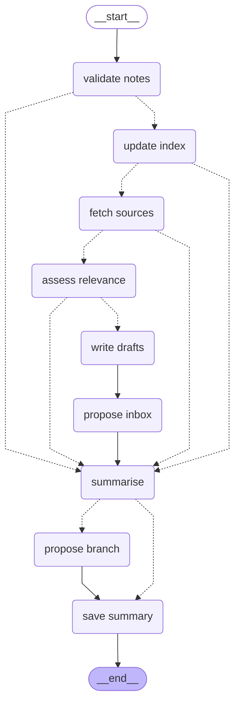

# The weekly run as a graph

`app/agents/monitoring/weekly.py` runs the weekly monitoring as a
[LangGraph](https://github.com/langchain-ai/langgraph) state graph. Each step
is a node that starts the step's module as its own process. After a required
step, a conditional edge (dashed) goes on to the next step, or straight to the
summary when the step failed. The optional steps (drafts, inbox) always go on.
After the summary, the proposal branch is created only when there are drafts.

Regenerate this diagram after changing the steps:

```powershell
python -m app.agents.monitoring.weekly --diagram
```


